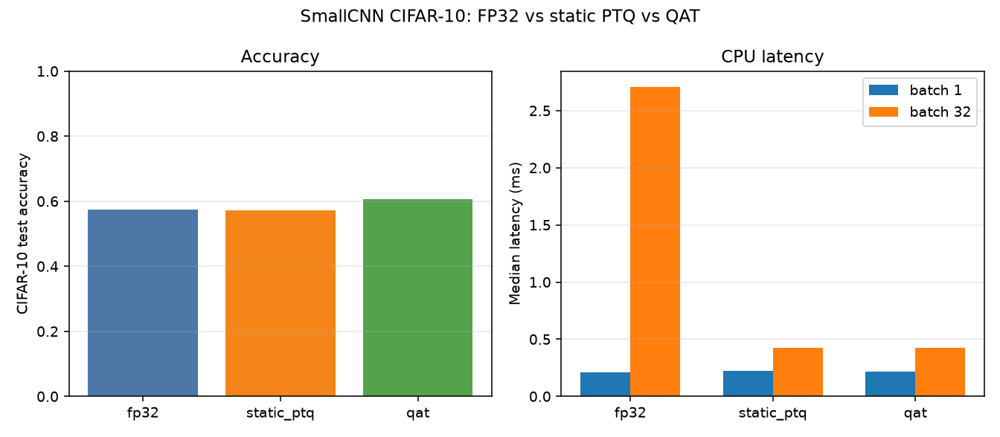
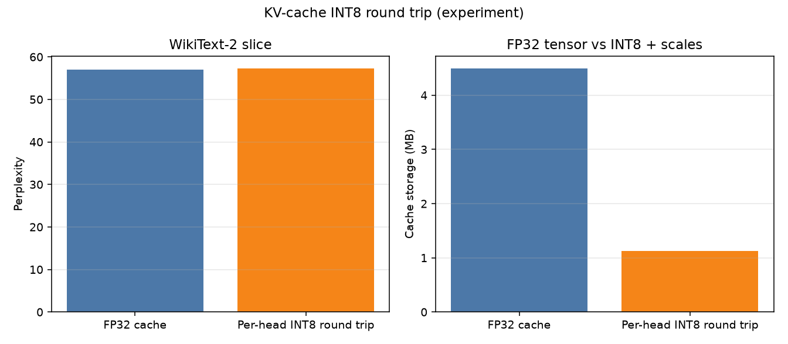

[](https://github.com/maxritter0714-sketch/int8-quantization-pytorch/actions/workflows/pytest.yml)

# INT8 quantization with PyTorch

Smaller checkpoints and KV caches are only useful if accuracy and CPU latency survive the conversion. This repository measures that, on one machine, for a finetuned DistilBERT, a small CIFAR-10 CNN, and DistilGPT-2. The numbers below are from the commands in this file. They are not a leaderboard, and a speedup on this CPU is not a property of INT8 in general.

## Setup

Python 3.11. CI runs `pytest` on `ubuntu-latest` with the CPU wheel. The measurements used CPython 3.11.18.

```bash
python3.11 -m venv .venv
source .venv/bin/activate
python -m pip install --upgrade pip
pip install -r requirements.txt
```

Run every script from the repository root.

## Reproduce

```bash
# DistilBERT, FP32 vs dynamic INT8. Full SST-2 validation (872 rows).
python src/quantize_dynamic.py --threads 4 --warmup 10 --runs 40

# DistilGPT-2 decode, use_cache true vs false, prompt lengths 32 / 128 / 512.
python src/kv_cache.py --threads 4

# CIFAR-10 SmallCNN: train 4 epochs, static PTQ (256-image prefix), 1 epoch of QAT.
python src/train_cnn.py --epochs 4 --qat-epochs 1 --calib-samples 256 --threads 4 --warmup 10 --runs 40

# Experiment: per-head INT8 round trip of the KV cache on a WikiText-2 prefix.
python src/kv_cache_int8.py --threads 4 --seq-len 128 --max-tokens 512

pytest
```

`src/quantize_static.py` and `src/qat.py` reload `results/cnn_fp32.pt` (gitignored) if you want to repeat only one conversion. `--limit N` on the DistilBERT script scores a prefix of the validation split instead of all 872 rows.

## Results

Recorded on 2026-10-29. The guest CPU is reported as **Intel(R) Xeon(R) Processor** (no SKU), 4 logical CPUs, Linux 6.12.94+. Flags: `avx avx2 avx512f avx512_vnni avx_vnni fma amx_int8 amx_bf16`. Torch `2.15.0+cpu`, Python 3.11.18, `torch.set_num_threads(4)`. Dynamic INT8 used the `fbgemm` engine. CNN static PTQ and QAT used the `x86` qconfig. Median and p90 are wall-clock milliseconds after warmup. CSVs are the source of truth; the table is rounded.

| Experiment | Method | Footprint | Quality | Batch 1 median (p90) | Batch 32 median (p90) |
| --- | --- | --- | --- | --- | --- |
| DistilBERT SST-2 | FP32 | 255.45 MB | 0.9106 acc (794/872) | 19.49 ms (21.63) | 583.29 ms (590.37) |
| DistilBERT SST-2 | Dynamic INT8, `nn.Linear` | 132.29 MB | 0.9002 (785/872) | 11.47 ms (12.89) | 332.18 ms (339.17) |
| SmallCNN CIFAR-10 | FP32, 4 epochs | 0.364 MB | 0.5735 (5735/10000) | 0.21 ms (0.25) | 2.71 ms (2.89) |
| SmallCNN CIFAR-10 | Static PTQ, 256 calib | 0.102 MB | 0.5730 (5730/10000) | 0.22 ms (0.26) | 0.43 ms (0.51) |
| SmallCNN CIFAR-10 | QAT, plus 1 epoch | 0.102 MB | 0.6051 (6051/10000) | 0.22 ms (0.24) | 0.42 ms (0.46) |
| distilgpt2, prompt 512 | `use_cache=True` | 18.0 MB KV | — | 76.22 tokens/s | — |
| distilgpt2, prompt 512 | `use_cache=False` | 18.0 MB KV | — | 10.89 tokens/s | — |
| distilgpt2, WikiText-2 prefix | FP32 cache (experiment) | 4.50 MB at seq 128 | ppl 57.02 (508 tokens) | — | — |
| distilgpt2, WikiText-2 prefix | Per-head INT8 round trip | 1.125 MB stored | ppl 57.35 | — | — |

CIFAR-10 is used because the recorded `train_cnn.py` command finished in 62 seconds on this host once the dataset was in the Hugging Face cache, so falling back to MNIST was unnecessary. The network is three conv-relu-pool stages (32, 64, 128 channels), global average pooling, and a linear head: 94,538 parameters, no batch norm. Static PTQ is FX graph mode (`prepare_fx` / `convert_fx`). QAT is `prepare_qat_fx`, one fine-tune epoch, then `convert_fx`.






Cache bytes at prompt lengths 32, 128, and 512 were 1.125 MB, 4.5 MB, and 18.0 MB, and the measured tensors matched `2 * layers * heads * head_dim * seq_len * 4` exactly. Cached tokens/s at those lengths were 147.11, 130.07, and 76.22, against 78.39, 40.53, and 10.89 without the cache.

## Takeaways

- Dynamic INT8 cut DistilBERT from 255.45 MB to 132.29 MB (1.93×, not 4×, because the embedding stayed FP32) and missed 9 more SST-2 validation items. Median latency on this CPU improved 1.70× at batch 1 and 1.76× at batch 32. p90 stayed within a few percent of the median at batch 32, and about 11–12% above it at batch 1.
- Static PTQ on the CNN cut the state dict 3.56× (0.364 MB to 0.102 MB) and lost 5 test images out of 10,000. Batch-1 latency did not improve (0.22 ms vs 0.21 ms). Batch-32 median latency fell from 2.71 ms to 0.43 ms (6.4×); p90 fell from 2.89 ms to 0.51 ms.
- QAT landed at the same INT8 size and the same batch-32 speed, with test accuracy 0.6051 against 0.5735 for the 4-epoch FP32 model. That run is an extra fine-tune epoch. This table has no 5th FP32 epoch to separate "more training" from "quantization-aware training."
- The KV cache grew linearly and, at 512 tokens, cached decode was 7.0× the tokens/s of recomputing the prefix (76.22 vs 10.89). Throughput still fell as the prompt grew, because each new token attends over the stored keys and values.
- The INT8 cache result is an experiment, not a kernel. A symmetric per-head round trip changed perplexity from 57.02 to 57.35 on a 508-token WikiText-2 prefix (stepwise FP32 matched a one-shot forward at 57.02). The stored form would be 4.50 MB to 1.125 MB. The process still holds FP32 tensors after the round trip.

## Limitations

- CPU only, and only small models (DistilBERT, a 95k-parameter CNN, DistilGPT-2). Nothing here transfers to a 7B model or a GPU by itself.
- One KVM guest. The CPU string has no SKU. Medians and p90s describe these runs.
- Dynamic and static INT8 do not guarantee a speedup. The CNN's batch-1 result is the counterexample: the integer conv did not pay for its overhead. The DistilBERT speedup showed up on a host that advertises AVX-512 VNNI and AMX-INT8.
- QAT accuracy is not a pure INT8-versus-FP32 comparison. The fine-tune is an extra epoch.
- Calibration is the first 256 training images, not a random draw. CIFAR-10 accuracy is modest because the network is small and trained for four epochs.
- The KV INT8 path dequantizes back to FP32 before the next attention call. It measures numeric damage and a hypothetical storage size. It does not measure an INT8 attention kernel.
- `torch.ao.quantization` (`quantize_dynamic`, `prepare_fx`, `convert_fx`, `prepare_qat_fx`) is the API these scripts call. Current PyTorch marks it deprecated and points new work at torchao.

## Layout

```text
src/benchmark.py          size, latency, hardware, CSV
src/quantize_dynamic.py   DistilBERT FP32 vs dynamic INT8
src/kv_cache.py           use_cache throughput and measured KV bytes
src/kv_cache_int8.py      per-head INT8 round trip, WikiText-2 perplexity
src/models/cnn.py         SmallCNN
src/cifar10.py            CIFAR-10 tensors from uoft-cs/cifar10
src/train_cnn.py          train, static PTQ, QAT, CSV, plot
src/quantize_static.py    static PTQ from a saved FP32 checkpoint
src/qat.py                QAT fine-tune from a saved FP32 checkpoint
src/cnn_quantize.py       FX prepare/convert helpers
tests/                    pytest, no checkpoint downloads
results/                  CSVs and PNGs from the commands above
```
