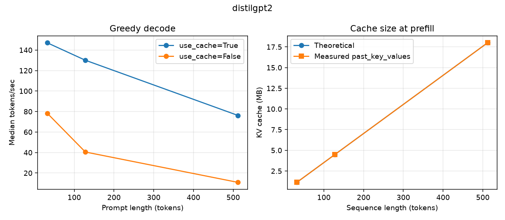

# INT8 quantization with PyTorch

A small, reproducible measurement project: how dynamic INT8 quantization changes on-disk size, CPU latency, and accuracy for a finetuned DistilBERT, and how a KV cache trades memory for decode speed on a small GPT-2.

The numbers below come from one machine and one command each. They are not a leaderboard. Dynamic quantization often shrinks a checkpoint more reliably than it speeds up CPU inference. On the host used here it did both; that speedup is tied to this CPU and is not something to assume elsewhere.

## Setup

Python 3.11. The CI workflow installs this file on `ubuntu-latest` (CPU). The run recorded below used CPython 3.11.18.

```bash
python3.11 -m venv .venv
source .venv/bin/activate
python -m pip install --upgrade pip
pip install -r requirements.txt
```

`requirements.txt` pulls the CPU wheel of PyTorch (`torch==2.15.0+cpu`) from the PyTorch wheel index, plus pinned `transformers`, `datasets`, `matplotlib`, and `pytest`. Run the scripts from the repository root so `src/` is on the import path.

## Reproduce

### DistilBERT, FP32 vs dynamic INT8

Model: `distilbert-base-uncased-finetuned-sst-2-english`.

`torch.ao.quantization.quantize_dynamic` replaces `nn.Linear` with dynamic INT8 (weights stored as integers, activations quantized at runtime). Embeddings and layer norms stay FP32. Accuracy is argmax accuracy on the GLUE SST-2 validation split from `nyu-mll/glue` (872 labeled rows). The bare Hub id `glue` is no longer accepted by current `huggingface_hub`. `--limit N` scores only the first N rows of that split (a prefix, not a random sample). The committed CSV used the full split.

Latency uses synthetic token ids of length `--seq-len` (default 128) at batch sizes 1 and 32, after a warmup, with `torch.set_num_threads` pinned for the timed calls. Median and p90 are over those timed calls only.

```bash
# Command that wrote results/distilbert_sst2_dynamic_int8.csv
python src/quantize_dynamic.py --threads 4 --warmup 10 --runs 40

# Shorter accuracy prefix
python src/quantize_dynamic.py --limit 256 --warmup 5 --runs 30 --threads 1
```

### KV cache

Model: `distilgpt2` (or pass `--model sshleifer/tiny-gpt2`).

For prompt lengths 32, 128, and 512 the script generates `--new-tokens` greedy tokens (default 16) with `use_cache=True` and `use_cache=False`, and records the median tokens/sec. Theoretical KV bytes at batch 1 are:

```text
2 * layers * kv_heads * head_dim * seq_len * bytes_per_value
```

For DistilGPT-2, `kv_heads` equals `n_head` (6 layers, 12 heads, head dim 64, FP32). The measured size is the key and value tensors in `past_key_values` after a prefill of that prompt length. Generated tokens are not included in the byte count. Shapes are stored in the CSV.

```bash
# Command that wrote results/kv_cache.csv and results/kv_cache.png
python src/kv_cache.py --threads 4

python src/kv_cache.py --model sshleifer/tiny-gpt2 --new-tokens 8 --runs 3
```

### CNN static PTQ and QAT

Not in this revision. `src/models/cnn.py`, `src/train_cnn.py`, `src/quantize_static.py`, and `src/qat.py` are stubs and raise `NotImplementedError`.

### Tests

```bash
pytest
```

Smoke tests build tiny local modules (including a random GPT-2 config). They do not download DistilBERT or DistilGPT-2. GitHub Actions runs `pytest` on push and pull request with Python 3.11 and the CPU wheel.

## Results

Recorded on 2026-10-29. The hypervisor only exposes the CPU as **Intel(R) Xeon(R) Processor** (no SKU), 4 logical CPUs, x86_64, Linux 6.12.94+. Flags present: `avx avx2 avx512f avx512_vnni avx_vnni fma amx_int8 amx_bf16`. Torch `2.15.0+cpu`, CPython 3.11.18. Quantized engine: `fbgemm`. Intra-op threads pinned to 4 for both scripts. The CSVs are the source of truth; the tables are rounded.

### DistilBERT SST-2

Full validation split, 872 rows. Latency: synthetic token ids, sequence length 128, warmup 10, 40 timed runs.

| Method | Size (MB) | Accuracy | Batch | Median (ms) | p90 (ms) |
| --- | --- | --- | --- | --- | --- |
| FP32 | 255.45 | 0.9106 (794/872) | 1 | 19.49 | 21.63 |
| FP32 | 255.45 | 0.9106 (794/872) | 32 | 583.29 | 590.37 |
| Dynamic INT8 | 132.29 | 0.9002 (785/872) | 1 | 11.47 | 12.89 |
| Dynamic INT8 | 132.29 | 0.9002 (785/872) | 32 | 332.18 | 339.17 |

All 38 `nn.Linear` modules were converted. Embeddings stayed FP32, so the checkpoint went from 255.45 MB to 132.29 MB (1.93×), not 4×. Accuracy dropped by 9 examples (1.03 percentage points). On this CPU, median latency improved by 1.70× at batch 1 and 1.76× at batch 32. At batch 32, p90 is within about 2% of the median. At batch 1, p90 is about 11–12% above the median. That spread is smaller than the FP32–INT8 gap. Batch 32 takes about 30× the batch-1 wall time, so the per-example time barely changes at this sequence length.

### KV cache

`distilgpt2`, greedy decode of 16 new tokens, warmup 2, 10 timed runs, batch 1. Theoretical and measured cache bytes match exactly at every length (FP32, shape `(1, 12, seq, 64)` per key and value tensor, 6 layers).

| Prompt length | use_cache | Median tokens/sec | Median ms | KV bytes | KV (MB) |
| --- | --- | --- | --- | --- | --- |
| 32 | true | 147.11 | 108.79 | 1,179,648 | 1.125 |
| 32 | false | 78.39 | 204.11 | 1,179,648 | 1.125 |
| 128 | true | 130.07 | 123.01 | 4,718,592 | 4.5 |
| 128 | false | 40.53 | 394.76 | 4,718,592 | 4.5 |
| 512 | true | 76.22 | 209.93 | 18,874,368 | 18.0 |
| 512 | false | 10.89 | 1469.22 | 18,874,368 | 18.0 |

Cache bytes scale linearly with length (32 → 128 → 512 is ×4 each step, and so is the byte count). Decode without the cache falls off faster: at 512 tokens the cached run is about 7.0× the tokens/sec of the uncached run (76.22 vs 10.89). With the cache, tokens/sec still drops as the prompt grows, because each new token still attends over the stored keys and values.



## Methods

- **On-disk size.** `torch.save` of the `state_dict`, then the file size in bytes. The zip container is included. Quantized linear weights are stored packed, so an INT8 checkpoint is smaller even though embeddings stay FP32.
- **CPU latency.** Warmup, then N wall-clock calls under `torch.inference_mode` and a fixed `torch.set_num_threads`. Median and linear-interpolation p90. No GPU synchronization, because these runs are CPU-only.
- **Accuracy.** SST-2 validation labels, argmax over the two logits. Unlabeled rows (`label < 0`) are skipped. `--limit` was not used for the table above.
- **Dynamic INT8.** `quantize_dynamic(..., {nn.Linear}, dtype=torch.qint8)`. PyTorch marks this eager API as deprecated and points new work at torchao. The call is still the one this experiment reports. The process selects the first available engine among `fbgemm`, `x86`, `onednn`, and `qnnpack`.
- **KV cache.** Greedy `generate` with `min_new_tokens=max_new_tokens`. Tokens/sec is the median of per-run rates (`new_tokens / seconds`). The theoretical size is the dense formula above; the measured size sums unique key/value tensor bytes after the prefill.

## Limitations

- CPU only, and only small models (DistilBERT, about 66M parameters; DistilGPT-2, about 82M). Nothing here transfers automatically to a 7B model or to a GPU.
- One KVM guest. The guest CPU string has no SKU. Median and p90 over 40 (DistilBERT) or 10 (KV cache) calls after warmup describe this run; they are not a multi-machine interval.
- Dynamic PTQ does not guarantee a speedup. It quantizes activations on every linear call, and that overhead can cancel a cheaper integer GEMM. This host advertises AVX-512 VNNI and AMX-INT8, and here INT8 was faster as well as smaller. On a CPU without a fast INT8 path, the same conversion can mainly reduce the file size. Read the latency columns as measurements of one CPU, not as a property of INT8.
- The size win is capped by whatever is left in FP32. Here that is mostly the embedding table.
- `--limit` is a prefix of the validation split. The committed accuracy number does not use it. A prefix is comparable across two methods in the same run and is not a confidence interval for the full split.
- The KV formula assumes a dense cache, batch 1, and the weight dtype's byte width. On this DistilGPT-2 run the measured tensors matched that formula. If `cache_shapes` shows a longer allocation or another dtype, the byte counts will differ, and that difference is the result.
- Static PTQ, QAT, and the CNN are not implemented yet.

## Next steps

- Train the small CNN and add static PTQ (calibration, FX or torchao PT2E, `fbgemm` / `x86`), then the same size, latency, and accuracy columns.
- Optional QAT, and a short perplexity check if cache values are rounded to INT8.
- A notebook that only reads the CSVs already written here.

## Layout

```text
src/benchmark.py          size, latency, hardware, CSV
src/quantize_dynamic.py   DistilBERT FP32 vs dynamic INT8
src/kv_cache.py           use_cache and theoretical vs measured KV bytes
src/models/cnn.py         week-2 stub
src/train_cnn.py          week-2 stub
src/quantize_static.py    week-2 stub
src/qat.py                week-2 stub
tests/                    pytest smoke tests, no large downloads
results/                  CSV and PNG written by the scripts
.github/workflows/pytest.yml
```
